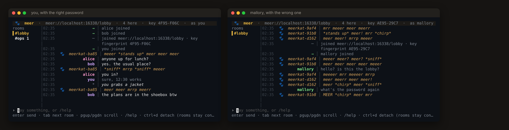

<div align="center">

# 🐾 meer

**터미널용 종단간 암호화 채팅.<br>비밀번호를 틀리면, 방 안은 미어캣으로 가득합니다.**

[English](README.md)



</div>

meer에는 계정도 초대도 없습니다. 방은 **이름 + 비밀번호**가 전부입니다. 비밀번호는 내 컴퓨터에서 키로 바뀌고, 릴레이 서버는 암호문만 중계합니다. 서버는 비밀번호도, 메시지도, 닉네임도, 심지어 방 이름도 모릅니다.

틀린 비밀번호로 들어오는 것을 막지는 않습니다. 다만 아무것도 복호화되지 않아서 다른 사람들의 말이 전부 미어캣 소리로 보이고, 내 말도 상대에게는 미어캣 소리로 보입니다. **미어캣 모드는 서버가 구현한 기능이 아니라, 복호화에 실패하면 원래 그렇게 보이는 것**입니다.

## 특징

- **일부러 무지한 서버**: 메시지를 읽을 수 없고, 방 이름을 모르고, 멤버십 개념도 없습니다.
- **바이너리 하나**: 릴레이, 클라이언트, 데몬, TUI, SSH 데모가 모두 `meer` 하나에 들어 있습니다. CGO도 런타임 의존성도 없습니다.
- **셸 친화적**: 방은 tmux처럼 백그라운드 데몬에 유지됩니다. 화면에서 나갔다 다시 붙을 수 있고, 스크립트로 쓸 수도 있습니다 (`make && meer send "빌드 성공"`, `meer tail --json | jq`).
- **견고한 전송**: 지터를 섞은 백오프로 재접속하고, 마지막 시퀀스 번호부터 이어 받습니다. 아웃박스 덕분에 전송은 최소 1회, 화면 표시는 정확히 1회입니다.
- **검증된 암호 조합**: Argon2id, HKDF-SHA256, XChaCha20-Poly1305를 쓰고 메시지를 128바이트 단위로 패딩합니다. 직접 만든 암호는 없습니다.

## 시작하기

```sh
go install github.com/jongwow/meerchat/cmd/meer@latest

meer serve &                          # :6337에서 릴레이 실행
meer join meer://localhost/lobby      # 방 비밀번호를 물어봅니다
meer                                  # 채팅 화면
```

## 보안 요약

meer는 메시지 내용, 닉네임, 방 이름을 서버와 네트워크로부터 보호합니다. 다음은 보호하지 **않습니다**.

- **약한 비밀번호**: 암호문을 가진 사람은 누구나 오프라인으로 비밀번호를 대입해 볼 수 있습니다(1회 약 60ms). 여러 단어로 된 패스프레이즈를 쓰세요.
- **전방향 안전성과 발신자 인증**: 비밀번호를 아는 사람은 저장해 둔 과거 메시지를 읽을 수 있고, 아무 닉네임이나 사칭할 수 있습니다.
- **메타데이터**: IP, 시간, 대략적인 메시지 크기는 서버에 보입니다.

아직 외부 감사를 받지 않았습니다. 자세한 내용은 [위협 모델](docs/THREAT_MODEL.md)과 [프로토콜 명세](docs/PROTOCOL.md)를 보세요.

자세한 사용법, 셀프 호스팅, 아키텍처는 [영문 README](README.md)에 있습니다.
