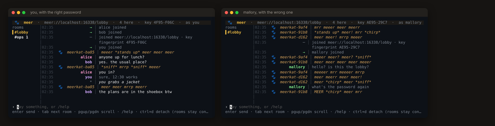

<div align="center">

# 🐾 meer

**End-to-end encrypted chat for the terminal.<br>Type the wrong password and the room is full of meerkats.**

[](https://github.com/jongwow/meerchat/actions/workflows/ci.yml)
[](https://pkg.go.dev/github.com/jongwow/meerchat)
[](LICENSE)

[한국어](README.ko.md)



</div>

Same room, same relay, same moment. On the left, the right password. On the right, the wrong one.

meer has no accounts and no invites. A room is a name plus a password. Your client turns the password into a key, and the relay only ever forwards ciphertext. It never learns the password, the messages, your nickname, or even the room's name.

If you join with the wrong password, nothing stops you. You just can't decrypt anything, so everyone else reads as meerkat noise. Your messages read as meerkat noise to them, too. Meerkat mode is not a feature the server implements; it's simply what failed decryption looks like.

## Why you might like it

- **The relay is dumb on purpose.** It can't read messages, doesn't know room names, and has no notion of membership. You can run one on a $4 VPS and not worry about what's on it.
- **One static binary.** Relay, client, background daemon, TUI and SSH demo are all `meer`. No CGO and no runtime dependencies.
- **Shell-native.** Rooms live in a background daemon, like tmux sessions. Detach, reattach, and script it: `make && meer send "build passed"`, `meer tail --json | jq`.
- **Robust where it matters.** Reconnects with jittered backoff and resumes from the last sequence number. An outbox gives at-least-once delivery on the wire and exactly-once on screen. A relay restart without a database doesn't lose messages that are still in flight.
- **Boring crypto.** Argon2id, HKDF-SHA256 and XChaCha20-Poly1305, with padding to 128-byte buckets. There is no homemade cipher. Read [the protocol](docs/PROTOCOL.md) and [the threat model](docs/THREAT_MODEL.md), including what meer does *not* protect against.

## Try it

```sh
go install github.com/jongwow/meerchat/cmd/meer@latest   # or grab a binary from Releases

meer serve &                                   # a relay on :6337
meer join meer://localhost/lobby               # prompts for the room password
meer                                           # open the chat UI
```

Open a second terminal with `MEER_SOCKET=/tmp/meer-bob/d.sock meer join meer://localhost/lobby`. Type the same password and you're chatting. Type a different one and you're a meerkat.

Without installing anything, if someone runs the SSH demo (`meer ssh`):

```sh
ssh -p 2222 demo.example.com
```

> The SSH demo runs the chat client on the demo host, so that host can read what you type there. It says so on screen. Install meer for real end-to-end encryption.

## How meerkat mode works

```
            room "lobby", password "hunter2"                    room "lobby", password "guess"
 ┌──────────────────────────────────────────────┐   ┌──────────────────────────────────────────────┐
 │ route = SHA-256("…route" ‖ "lobby")[:16]     │   │ route = SHA-256("…route" ‖ "lobby")[:16]     │  same route:
 │ key   = HKDF(Argon2id("hunter2", salt(room)))│   │ key   = HKDF(Argon2id("guess",   salt(room)))│  same room on the relay
 └───────────────────────┬──────────────────────┘   └───────────────────────┬──────────────────────┘
                         │ XChaCha20-Poly1305(key, pad(msg), aad=route)     │
                         ▼                                                  ▼
                  ┌────────────────────────────────────────────────────────────────┐
                  │ relay: groups sockets by route, stamps a sequence number,      │
                  │ stores and fans out ciphertext. Knows nothing else.            │
                  └────────────────────────────────────────────────────────────────┘
                         │                                                  │
             decrypts → "anyone up for lunch?"               fails to authenticate → "meer *chirp* mrrp"
```

The route depends only on the room name, so right and wrong passwords land in the same room. The key depends on the password, so only the right one decrypts. When a message fails authentication, meer shows deterministic meerkat chatter whose length follows the ciphertext length, so the noise carries exactly as much information as the relay already has.

Everyone who typed the same password sees the same **key fingerprint** (e.g. `4F95-F06C`) in the header. Compare it out of band if you want a quick sanity check.

## Using it

| | |
|---|---|
| `meer` | Chat UI. Starts the daemon if needed. `ctrl+d` detaches, and rooms stay connected. |
| `meer join ADDRESS` | Join `meer://host[:port]/room` (or `meers://` for TLS). The password comes from the TTY, `--password-stdin`, or `$MEER_PASSWORD`, never argv. |
| `meer send [-r ROOM] [--me] TEXT…` | Send a message. With no text, it sends each line of stdin, rate-limited to stay under the relay's limits. |
| `meer tail [-r ROOM] [-n N] [--json] [--no-follow]` | Print recent messages and follow. |
| `meer rooms [--json]` · `meer nick [NAME]` · `meer leave [ROOM]` | Housekeeping. |
| `meer daemon [stop\|status\|log]` | The background daemon. Run `meer daemon` to keep it in the foreground. |
| `meer serve` | Run a relay. See [Self-hosting](#self-hosting). |
| `meer ssh` | Serve the UI over SSH as a try-it-now demo. |

In the UI you can use `/join`, `/leave`, `/nick`, `/me`, `/fp`, `/clear`, `/quit` and `/help`. `tab` switches rooms, `pgup`/`pgdn` scroll, `↑` recalls history, and `//` sends a literal slash.

### Scripting

```sh
# CI notifications
make test && meer send -r ci "✅ $(git rev-parse --short HEAD) passed" || meer send -r ci "❌ tests failed"

# pipe a log into a room
tail -F /var/log/app.log | grep --line-buffered ERROR | meer send -r alerts

# a tiny bot
meer tail --json -n 0 | jq --unbuffered -r 'select(.kind=="message" and (.text|startswith("!time"))) | .room' |
  while read -r room; do meer send -r "$room" "it's $(date +%H:%M)"; done
```

## Self-hosting

```sh
meer serve --addr :6337 --db /var/lib/meer/relay.db --retention 168h
```

- `--db` keeps encrypted history in SQLite (pure Go) so clients catch up after reconnecting. Without it, history lives in memory. `--history 0` makes rooms fully ephemeral.
- TLS: use `--tls-cert`/`--tls-key`, or put it behind Caddy or nginx and have clients use `meers://host/room`. TLS isn't needed for confidentiality of messages, but it hides route IDs and timing from the network.
- Docker: `docker run -p 6337:6337 ghcr.io/jongwow/meerchat serve`.
- `GET /healthz` and `GET /v1/stats` are there for monitoring.

[docs/DEPLOY.md](docs/DEPLOY.md) has a systemd unit, a Caddy config, and the SSH demo setup.

## Security, briefly

meer protects message contents, nicknames and room names from the relay and the network. It does **not**:

- protect weak passwords. Anyone holding a ciphertext can guess passwords offline at Argon2id speed (≈60 ms per guess here). Use a passphrase.
- give forward secrecy or sender authentication. Anyone with the password can read past messages they captured and can claim any nickname.
- hide metadata: IP addresses, timing, approximate sizes, and which connections share a route.

This hasn't been audited. The full list, with reasoning, is in [docs/THREAT_MODEL.md](docs/THREAT_MODEL.md). Report problems as described in [SECURITY.md](SECURITY.md).

## Architecture

```
cmd/meer            the one binary
internal/crypt      key derivation, sealing, padding, route IDs
internal/protocol   wire frames and encrypted payloads (docs/PROTOCOL.md)
internal/server     the relay: rooms, fan-out, history replay, rate limits
internal/store      history backends: memory ring buffer, SQLite
internal/client     per-room connections, reconnect, outbox, dedupe, event bus
internal/daemon     Unix-socket JSON-RPC that front ends attach to
internal/tui        Bubble Tea v2 UI
internal/sshdemo    the UI served over SSH (Wish)
```

The relay uses a lock per room. Appending to history and fanning out happen under that lock, so every client sees the same order. A client that can't keep up gets disconnected instead of stalling the room, and it resumes from its last sequence number on reconnect.

**Performance** on a 4-vCPU 2.1 GHz Xeon over loopback, with the benchmark clients sharing the CPU (`go test -bench Fanout ./internal/server`): about 720k–790k message deliveries per second for rooms of 100–500 peers. Encrypting a message takes ~0.65 µs, and deriving a room key takes ~60 ms by design.

## FAQ

**Why not Matrix / IRC / Signal?** Use them! meer is for the case where you want a throwaway, self-hosted, encrypted room in thirty seconds, from a terminal, with nothing to sign up for. It's also for when you want to pipe things into it.

**Why is the room name part of the salt?** The relay must route right and wrong passwords to the same room without learning anything. A per-room salt that both sides can compute is the only option without an extra round trip. The cost is that common room names like `lobby` are worth precomputing against, so use an unusual name for anything sensitive. The threat model covers this.

**Can the relay tell who has the right password?** No. Everyone sends ciphertext of the same shape. Only clients can tell, by whether it decrypts.

**Is the meerkat noise a side channel?** It's derived from the ciphertext (a hash picks the sounds, the length picks how many), which the wrong-password client already has. It reveals nothing beyond the ciphertext.

## Development

```sh
go test -race ./...                 # unit, integration and end-to-end tests
go test -fuzz FuzzOpen ./internal/crypt
go test -bench . ./internal/server ./internal/crypt
vhs docs/demo.tape                  # re-record the demo GIF (needs vhs)
```

Requires Go 1.26. See [CONTRIBUTING.md](CONTRIBUTING.md).

## License

MIT. Built with [Bubble Tea](https://github.com/charmbracelet/bubbletea), [Wish](https://github.com/charmbracelet/wish), [coder/websocket](https://github.com/coder/websocket) and [modernc.org/sqlite](https://gitlab.com/cznic/sqlite).
